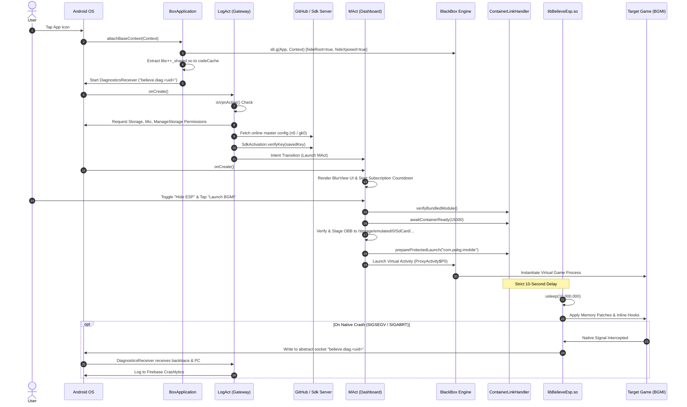

# End-to-End Application Execution Flow

## 1. Complete Execution Lifecycle Overview

The execution of ExoraLoader progresses through five distinct sequential phases:
1. **Bootstrap & Sandbox Initialization** (`BoxApplication`)
2. **Environment Validation & License Verification** (`LogAct`)
3. **Workspace Configuration & Asset Staging** (`MAct`)
4. **Virtual Container Execution** (`BlackBox` / `top.v.host`)
5. **Delayed Native Hooking & IPC Telemetry** (`libBelieveEsp.so` & `DiagnosticsReceiver`)



---

## 2. Phase-by-Phase Execution Details

### Phase 1: Bootstrap & Sandbox Initialization (`BoxApplication`)
- **File:** `com.miHoYo.GenshinImpact.BoxApplication`
- **Trigger:** Android OS instantiates the custom application subclass before any activities or services run.
- **Actions:**
  1. Calls `super.attachBaseContext(context)`.
  2. Passes the application context into `top.v.host.s8.g(this, context)`.
     - Sets `hideRoot = true` in container preferences.
     - Sets `hideXposed = true` in container preferences.
     - Installs virtual system service proxies into ART's internal cache.
  3. Verifies whether `libc++_shared.so` exists in `context.getCodeCacheDir()`.
     - If missing, it opens the host APK as a zip archive, locates `lib/arm64-v8a/libc++_shared.so`, and streams it directly to `codeCacheDir/libc++_shared.so`.
  4. Starts `FieldDiagnostics` to register uncaught Java exception handlers and native crash listeners.

### Phase 2: Environment Validation & License Gate (`LogAct`)
- **File:** `com.miHoYo.GenshinImpact.LogAct`
- **Trigger:** Declared with intent filters `<action android:name="android.intent.action.MAIN"/>` and `<category android:name="android.intent.category.LAUNCHER"/>`.
- **Actions:**
  1. **VPN Detection:**
     - Calls `isVpnActive()` using `ConnectivityManager.getNetworkCapabilities()`.
     - Checks for `NetworkCapabilities.TRANSPORT_VPN`.
     - If active, aborts initialization or flags suspicious environment to prevent proxy/mitm inspection.
  2. **Permission Verification & Requests:**
     - Verifies `READ_EXTERNAL_STORAGE`, `WRITE_EXTERNAL_STORAGE`, `RECORD_AUDIO`.
     - On Android 11+ (API 30+), verifies `Environment.isExternalStorageManager()`. If false, creates an intent for `Settings.ACTION_MANAGE_APP_ALL_FILES_ACCESS_PERMISSION`.
  3. **Remote Configuration Fetch:**
     - Uses internal helper `n5` to make an asynchronous HTTP GET request to a remote raw repository (e.g. GitHub raw URL).
     - Decrypts configuration JSON specifying current app version, active maintenance status, target game package override, and server status.
  4. **Key Verification:**
     - Reads stored license key from SharedPreferences.
     - If absent, displays activation modal with input field and validation button.
     - Submits key to licensing verification endpoint.
     - Upon confirmation, calculates remaining license duration and transitions to `MAct` via standard Android Intent.

### Phase 3: Workspace Staging & Setup (`MAct`)
- **File:** `com.miHoYo.GenshinImpact.MAct`
- **Actions:**
  1. Initializes the frosted glass dashboard using `eightbitlab.blurview.BlurView` overlaying a custom background view (`BelieveBackgroundView`).
  2. Starts a dynamic `CountDownTimer` displaying days, hours, minutes, and seconds until the user's license expiration.
  3. Binds the ESP concealment toggle (`switchHideEsp`). When enabled, flags the native layer to conceal overlay surfaces from screen capture APIs (`FLAG_SECURE`).
  4. Sets the default target package:
     ```java
     String targetPackage = "com.pubg.imobile"; // Battlegrounds Mobile India
     ```
  5. User taps the primary launch button (`btnLaunchGame`).

### Phase 4: Container Launch & OBB Synchronization
- **Trigger:** Invocation of `MAct.startDownloadAndLoadFlow()`.
- **Actions:**
  1. **Native Module Verification:**
     - Calls `ContainerLinkHandler.verifyBundledModule()`.
     - Ensures the bundled native payload (`libBelieveEsp.so`) is present and structurally intact.
  2. **Container Latch Wait:**
     - Calls `ContainerLinkHandler.awaitContainerReady(15000)` with a 15-second timeout.
     - Ensures BlackBox background daemons (`DaemonService`, `SystemCallProvider`) are online.
  3. **OBB Asset Preparation:**
     - Checks whether game expansion assets exist in the physical directory:
       `/storage/emulated/0/Android/obb/com.pubg.imobile/`
     - Ensures that the virtual sandbox path exists:
       `/storage/emulated/0/SdCard/Android/data/com.pubg.imobile/`
     - If needed, performs directory mirroring or symlink replication to allow the guest game to locate game data files without failing asset checks.
  4. **Launch Gate:**
     - Calls `ContainerLinkHandler.prepareProtectedLaunch("com.pubg.imobile")`.
     - Invokes the BlackBox launch dispatcher:
       `top.v.host.s8.launch("com.pubg.imobile", 0)`.
     - The container allocates an unused stub activity (e.g. `com.believeesp.proxy.ProxyActivity$P0`) and instructs the Android system to start it.
     - Inside the stub activity, BlackBox swaps the class loader, creates the guest `Application` instance, and invokes `com.epicgames.ue4.SplashActivity` or `com.tencent.tmgp.pubgmhd.MainActivity`.

### Phase 5: Delayed Native Hooking & IPC Crash Monitoring
- **Actions:**
  1. **10-Second Injection Delay:**
     - As the guest game initializes its Unreal Engine runtime and loads anti-cheat libraries (`libanogs.so`, `libTssSec.so`), `ContainerLinkHandler` triggers `scheduleDelayedInjection(10000)`.
     - The native worker thread in `libBelieveEsp.so` sleeps for 10 seconds.
     - Once the delay completes, the engine opens `/proc/self/maps`, resolves memory addresses for critical game functions (e.g., player entity pointers, camera projection matrices), and applies inline hooks.
  2. **Asynchronous Crash Telemetry:**
     - `DiagnosticsReceiver` listens on abstract Unix domain socket `believe.diag.<uid>`.
     - If the game crashes due to an illegal memory access inside hooked routines, the native signal handler catches `SIGSEGV`, queries the link register (`LR`) and program counter (`PC`), calculates offsets relative to `libBelieveEsp.so` or `libUE4.so`, and writes a formatted telemetry packet to the socket.
     - `DiagnosticsReceiver` receives the payload, strips local directory paths, and sends an event to Firebase Crashlytics.

