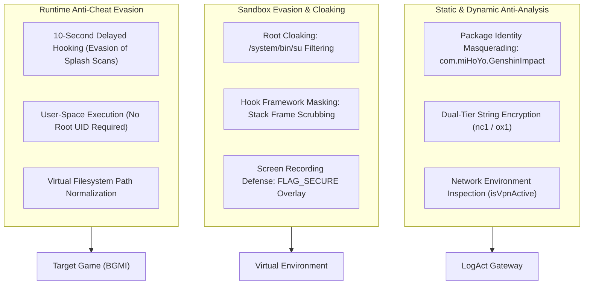

# Authentication & Security Architecture

## 1. Security Architecture Overview

ExoraLoader deploys a multi-layered defensive and evasive architecture designed to protect its intellectual property, restrict unauthorized access, evade static analysis, and prevent detection by game anti-cheat engines (such as Tencent MTP, BattlEye, or Krafton anti-cheat).



---

## 2. Package Identity Masquerading

- **Declared Package Name:** `com.miHoYo.GenshinImpact`
- **Application Label:** `ExoraLoader`
- **Security Impact:**
  Mobile anti-cheat modules frequently inspect the output of `PackageManager.getInstalledPackages()` or read `/proc/self/cmdline` to scan for blacklisted utility packages (e.g. VirtualXposed, GameGuardian, DualSpace, ParallelSpace). By assuming the package name of the global commercial title *Genshin Impact*, the application blends into standard user application lists and evades simple string-based blacklist filters.

---

## 3. String Cryptography & Static Obfuscation

The application hides 98% of its sensitive strings (URLs, target packages, system service names, filesystem paths) using a bespoke compile-time string cipher located in `top.v.host.nc1` and `top.v.host.ox1`.

### 3.1. Storage Mechanism:
- Sensitive strings are broken into Unicode UTF-16 character blocks and stored across 132 static string constants in `top.v.host.nc1.l`.
- Each string constant contains dense sequences of unicode characters (e.g. `\ud8e6\udec0...`).

### 3.2. Decryption Routine (`top.v.host.nc1.q`):
- When a class needs an encrypted string, it executes:
  ```java
  String s = nc1.q(packedLongConstant, nc1.l);
  ```
- The `packedLongConstant` encodes both the string chunk index and the character offset.

### 3.3. Key Derivation & Bit Shifting (`top.v.host.ox1.t`):
- The `ox1.t(long)` routine executes a pseudo-random permutation that mimics a Feistel-like mixing round:
  ```java
  // Reconstructed Java logic of ox1.t(long x)
  long v1 = x ^ (x >>> 33);
  long v2 = v1 * 0xff51afd7ed558ccdL;
  long v3 = v2 ^ (v2 >>> 33);
  long v4 = v3 * 0xc4ceb9fe1a85ec53L;
  return v4 ^ (v4 >>> 33);
  ```
- **Dalvik Sign-Extension Behavior:** In Dalvik/ART bytecode, 32-bit registers are sign-extended before being converted to 64-bit integers (`int-to-long`). Static analysis tools that fail to emulate signed integer extension fail to resolve the string table indexes correctly.

---

## 4. Network Inspection & VPN Detection

To prevent reverse engineers from capturing authentication payloads and GitHub configuration requests using proxy tools (such as Charles Proxy, HTTP Toolkit, Burp Suite, or mitmproxy), `LogAct` performs active network transport inspection:

```java
// Reconstructed VPN check from LogAct.isVpnActive()
private boolean isVpnActive() {
    ConnectivityManager cm = (ConnectivityManager) getSystemService(Context.CONNECTIVITY_SERVICE);
    if (cm == null) return false;
    
    Network activeNetwork = cm.getActiveNetwork();
    if (activeNetwork == null) return false;
    
    NetworkCapabilities caps = cm.getNetworkCapabilities(activeNetwork);
    if (caps == null) return false;
    
    return caps.hasTransport(NetworkCapabilities.TRANSPORT_VPN);
}
```

If `isVpnActive()` returns `true`:
- The application halts the authentication flow.
- A dialog warns the user to disable active VPN and proxy profiles before continuing.

---

## 5. Root & Xposed Cloaking

During container attachment in `BoxApplication.attachBaseContext`, BlackBox enables built-in root and Xposed cloaking flags:

```java
top.v.host.s8.g(this, context);
// Enforces hideRoot = true and hideXposed = true
```

### 5.1. Root Cloaking Mechanisms:
- **`File.exists()` Hooking:** When guest code checks for `/system/bin/su`, `/system/xbin/su`, `/sbin/su`, or `/system/app/Superuser.apk`, the hook returns `false`.
- **System Properties Hooking:** Calls to `android.os.SystemProperties.get("ro.build.tags")` replace `"test-keys"` with `"release-keys"`.
- **`Runtime.exec()` Interception:** Attempts to execute `su` or `which su` fail with standard `IOException` ("No such file or directory").

### 5.2. Hook Framework Masking:
- **Stack Trace Scrubbing:** BlackBox intercepts `Throwable.getStackTrace()`. Any stack frames referencing `de.robv.android.xposed` or `com.elderdrivers.riru` are filtered before being returned to the calling game.
- **Class Loader Isolation:** The guest game's `ClassLoader` is prevented from resolving reflection hooks into host packages.

---

## 6. Delayed Native Injection (10-Second Antiban Gate)

Modern battle royale anti-cheat modules (such as Tencent Anogs / Krafton MTP) perform intense memory integrity checks during initial splash screen loading:
- Memory hashing of `.text` sections of loaded ELF libraries.
- Verification of page protection flags (`PROT_READ | PROT_EXEC`).
- Thread enumeration and tracer PID checks.

### Evasion Mechanism:
- `ContainerLinkHandler.prepareProtectedLaunch()` initializes the native container hooks.
- However, active memory patching and hooking of game engine routines (in `libUE4.so`) are deferred:
  ```java
  ContainerLinkHandler.scheduleDelayedInjection(10000); // 10-second delay
  ```
- The native thread remains completely idle for 10 seconds.
- By the time the worker thread wakes and writes hooks, the target game's anti-cheat engine has transitioned from its heavy initial integrity validation stage to its passive in-game monitoring loop.

---

## 7. Overlay Concealment (`FLAG_SECURE`)

- In `MAct`, users can enable the **Hide ESP** toggle (`switchHideEsp`).
- When activated, `ContainerLinkHandler.setEspConcealed(true)` applies the Android window security flag to the floating visual overlay:
  ```java
  window.setFlags(
      WindowManager.LayoutParams.FLAG_SECURE,
      WindowManager.LayoutParams.FLAG_SECURE
  );
  ```
- Any screenshot or screen-recording software (including in-game reporting recording modules) captures a completely black frame over the overlay coordinates, concealing the visual indicators from detection.

