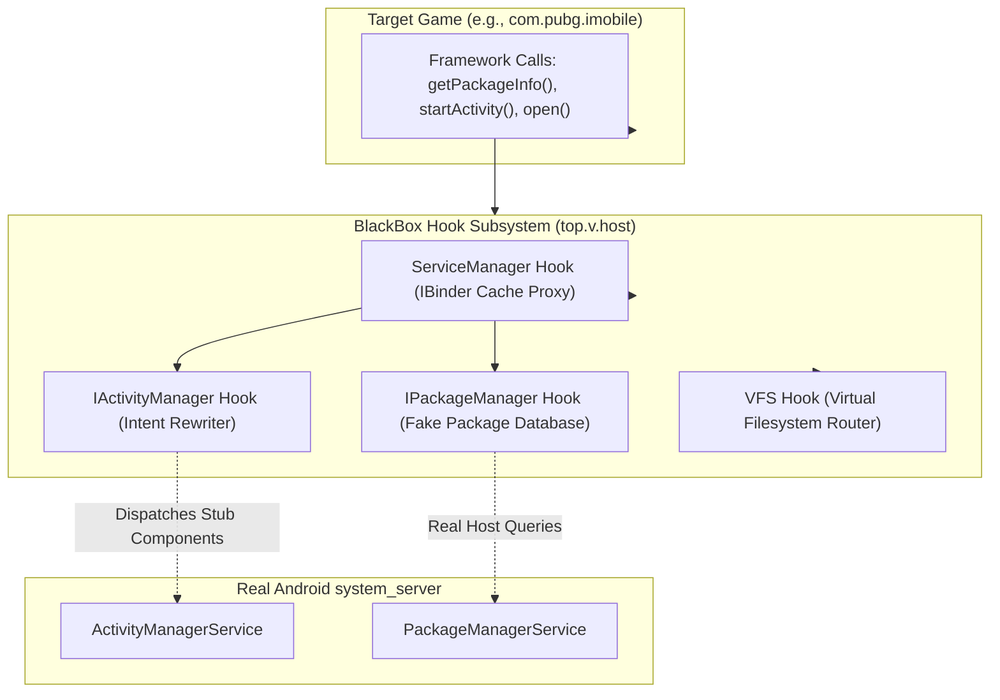

# Backend Virtualization Engine & System Logic

## 1. Virtualization Engine Overview

ExoraLoader's internal backend operates entirely in user space as a customized fork of the **BlackBox** Android virtualization runtime (authored originally by niunaijun / BlackReflection). It allows foreign Android APK packages to execute without installation on the host operating system.

The core packages implementing this virtualization backend are:
- `top.v.host.*`: The core framework services, hooked Binder proxies, and reflection utilities.
- `com.believeesp.core.*`: Daemon services, system call providers, and process lifecycle managers.
- `com.believeesp.proxy.*`: Pre-allocated Android stub manifest components.



---

## 2. System Service Interception & Binder Proxies

Android applications interact with system services via Binder IPC tokens managed by `android.os.ServiceManager`. BlackBox hijacks these tokens at process startup:

### 2.1. `ServiceManager` Cache Poisoning
Inside `top.v.host.s8.g()`, the container accesses `ServiceManager.sCache` (a private static `Map<String, IBinder>`) using reflection and replaces the underlying `IBinder` objects with dynamic proxies:

```java
// Conceptual reconstruction of BlackBox ServiceManager hooking
Class<?> serviceManagerClass = Class.forName("android.os.ServiceManager");
Field sCacheField = serviceManagerClass.getDeclaredField("sCache");
sCacheField.setAccessible(true);
Map<String, IBinder> sCache = (Map<String, IBinder>) sCacheField.get(null);

// Replace "package" with HookPackageManagerBinder
IBinder realBinder = sCache.get("package");
sCache.put("package", new HookPackageManagerBinder(realBinder));
```

### 2.2. Hooked Android Services Catalog

| Service Name | Hook Class | Purpose & Interception Behavior |
| :--- | :--- | :--- |
| **`package`** (`IPackageManager`) | `top.v.host.hook.pms.*` | Intercepts `getPackageInfo`, `getApplicationInfo`, `queryIntentActivities`. Convinces the guest game that it is installed natively on the device with valid signatures. |
| **`activity`** (`IActivityManager`) | `top.v.host.hook.ams.*` | Intercepts `startActivity`, `startService`, `bindService`. Rewrites target Intents to point to pre-allocated stub components (`ProxyActivity$P0`, etc.). |
| **`appops`** (`IAppOpsService`) | `top.v.host.hook.appops.*` | Intercepts runtime permission and app-op checks (e.g. storage, overlay window), returning `AppOpsManager.MODE_ALLOWED`. |
| **`window`** (`IWindowManager`) | `top.v.host.hook.wms.*` | Manages floating overlay window tokens and hides container window tags. |
| **`mount` / `storage`** (`IStorageManager`) | `top.v.host.hook.storage.*` | Intercepts volume query paths and emulates external storage directories. |
| **`job`** (`IJobScheduler`) | `top.v.host.hook.job.*` | Maps background jobs to `ProxyJobService$P0..P24`. |

---

## 3. The Stub Component Manifest Mechanism

Android's OS requires that any activity or service started via standard intents be declared in the host APK's `AndroidManifest.xml`. To launch unmanifested guest games dynamically, BlackBox uses the **Stub Manifest Pool**:

### Allocation and Intent Rewriting Workflow:
1. The guest game calls `context.startActivity(new Intent(context, SplashActivity.class))`.
2. The `IActivityManager` hook intercepts `startActivity(..., intent, ...)`.
3. The hook stores the target intent (`SplashActivity`) as an extra inside an envelope intent:
   ```java
   Intent stubIntent = new Intent();
   stubIntent.setComponent(new ComponentName(
       "com.miHoYo.GenshinImpact", 
       "com.believeesp.proxy.ProxyActivity$P0"
   ));
   stubIntent.putExtra("_B_|_target_intent_", targetIntent);
   stubIntent.putExtra("_B_|_user_id_", 0);
   ```
4. The system `ActivityManagerService` validates that `ProxyActivity$P0` is registered in `com.miHoYo.GenshinImpact`'s manifest and allows the launch.
5. In the new process, `ProxyActivity$P0.onCreate()` unpacks `_B_|_target_intent_`, instantiates `SplashActivity` using the virtual `ClassLoader`, and calls its lifecycle methods.

---

## 4. Virtual File System (VFS) Routing

To isolate the guest game while allowing it to persist state without root privileges, BlackBox intercepts filesystem paths at both the Java runtime (`java.io.File`) and native Bionic libc level:

### Directory Translation Table:

| Standard Android Path | Redirected Virtual Container Path | Purpose |
| :--- | :--- | :--- |
| `/data/data/<pkg>/` | `/data/data/com.miHoYo.GenshinImpact/virtual/users/0/<pkg>/` | Guest private databases, shared_prefs, and files |
| `/sdcard/Android/data/<pkg>/` | `/storage/emulated/0/SdCard/Android/data/<pkg>/` | External user caches and Unreal Engine game assets |
| `/sdcard/Android/obb/<pkg>/` | `/storage/emulated/0/Android/obb/<pkg>/` | Main and patch OBB files (mirrored/staged directly) |

---

## 5. Background Daemons & IPC Providers

The container maintains two dedicated persistent infrastructure components:

### 5.1. `com.believeesp.core.DaemonService`
- An isolated background service configured with an inner service (`DaemonInnerService`).
- Manages the container process group, ensuring that when the guest game crashes or is terminated, all associated child threads and mapped memory are cleaned up.

### 5.2. `com.believeesp.core.SystemCallProvider`
- A custom `ContentProvider` registered with the system.
- Acts as a local RPC bus across multiple container processes using `ContentProvider.call(method, arg, extras)`.
- Allows `LogAct` and `MAct` to query container initialization status, install packages into the virtual sandbox, and query active PID lists.

---

## 6. IPC Diagnostics Server (`DiagnosticsReceiver`)

- **Class:** `com.miHoYo.GenshinImpact.utils.DiagnosticsReceiver`
- **Socket:** Linux abstract Unix Domain Socket: `believe.diag.<uid>`
- **Workflow:**
  1. Instantiates `android.net.LocalServerSocket` binding to `believe.diag.` + `Process.myUid()`.
  2. Spawns a background thread running an infinite `accept()` loop.
  3. When `libBelieveEsp.so` native crash handler catches a fatal signal in the guest game, it establishes a connection to this local socket.
  4. Telemetry format received:
     ```
     CRASH|SIGSEGV|PC:0x0000007b89f10a24|LR:0x0000007b89f0fa12|LIB:libUE4.so+0x1f10a24
     ```
  5. The receiver parses the message and pushes it directly into `FieldDiagnostics.recordException()`.

