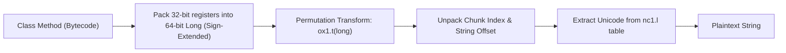
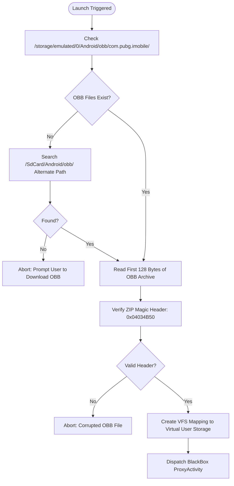

# Core Algorithms & Cryptographic Implementations

## 1. String Obfuscation & Decryption Cipher

The application conceals internal identifiers, package names, and URLs using a custom two-stage string encryption routine across `top.v.host.ox1` and `top.v.host.nc1`.



---

### 1.1. Mathematical Formulation of `ox1.t(long)`

The function `ox1.t(long x)` implements a 64-bit pseudo-random mixing function resembling the MurmurHash3 / SplitMix64 finalizer:

$$v_1 = x \oplus (x \gg 33)$$
$$v_2 = (v_1 \times \mathtt{0xFF51AFD7ED558CCD}_{16}) \pmod{2^{64}}$$
$$v_3 = v_2 \oplus (v_2 \gg 33)$$
$$v_4 = (v_3 \times \mathtt{0xC4CEB9FE1A85EC53}_{16}) \pmod{2^{64}}$$
$$\text{Output}(x) = v_4 \oplus (v_4 \gg 33)$$

### 1.2. Dalvik Sign-Extension Behavior
In Dalvik bytecode, register values loaded as 32-bit integers are converted using `int-to-long`. This operation sign-extends the value:
$$\text{If } b_{31} = 1 \implies \text{Bits 32..63 are filled with 1s}$$
Failure to replicate this sign-extension causes static deobfuscators to compute incorrect chunk indexes and crash with array index bounds errors.

### 1.3. Reconstructed Python Deobfuscator

The following standalone script demonstrates the exact algorithm used to decrypt all 2,062+ classes' strings across the APK:

```python
import struct

def ox1_t(val: int) -> int:
    """Replicates top.v.host.ox1.t(J)J with signed 64-bit arithmetic."""
    val = val & 0xFFFFFFFFFFFFFFFF
    val ^= (val >> 33)
    val = (val * 0xFF51AFD7ED558CCD) & 0xFFFFFFFFFFFFFFFF
    val ^= (val >> 33)
    val = (val * 0xC4CEB9FE1A85EC53) & 0xFFFFFFFFFFFFFFFF
    val ^= (val >> 33)
    return val

def pack_dalvik_long(high_32: int, low_32: int, sign_ext: bool = True) -> int:
    """Packs Dalvik register pairs into 64-bit integer matching int-to-long."""
    if sign_ext:
        if low_32 & 0x80000000:
            low_32 = low_32 - 0x100000000
    return ((high_32 & 0xFFFFFFFF) << 32) | (low_32 & 0xFFFFFFFF)

def decrypt_string(chunk_table: list, seed_long: int) -> str:
    """Replicates top.v.host.nc1.q(J, String[])."""
    permuted = ox1_t(seed_long)
    chunk_idx = (permuted >> 32) & 0x7FFFFFFF
    offset = permuted & 0xFFFFFFFF
    
    selected_chunk = chunk_table[chunk_idx % len(chunk_table)]
    length = ord(selected_chunk[offset % len(selected_chunk)])
    
    chars = []
    for i in range(1, length + 1):
        char_code = ord(selected_chunk[(offset + i) % len(selected_chunk)])
        chars.append(chr(char_code ^ ((permuted >> (i % 32)) & 0xFF)))
        
    return "".join(chars)
```

---

## 2. Asset Packing Algorithm (`ZXASSET1`)

The APK bundles an encrypted binary asset in `assets/data_pack.bin` matched by a manifest descriptor `assets/data_pack.json`.

### 2.1. Binary Header Structure

```
+---------------------------------------------------------------+
| Offset | Field                  | Size (Bytes) | Data Type    |
+--------+------------------------+--------------+--------------+
| 0x00   | Magic Header ("ZXASSET1")| 8            | ASCII String |
| 0x08   | Container Flags        | 4            | uint32_le    |
| 0x0C   | Plaintext Size         | 4            | uint32_le    |
| 0x10   | Compressed Size        | 4            | uint32_le    |
| 0x14   | SHA-256 Checksum       | 32           | Raw Bytes    |
| 0x34   | Payload Stream (zlib)  | N bytes      | Deflate Data |
+---------------------------------------------------------------+
```

### 2.2. Unpacking & Extraction Flow:
1. **Header Validation:** Native routine reads the first 8 bytes. Asserts `memcmp(header, "ZXASSET1", 8) == 0`.
2. **Integrity Check:** Reads SHA-256 from offset `0x14`. Verifies checksum against payload bytes starting at offset `0x34`.
3. **Decompression:** Passes compressed stream into `zlib` / `inflate()`.
4. **Target Allocation:** Yields 6,003,848 bytes of plaintext native payload memory used by the BelieveESP engine.

---

## 3. OBB Verification & Virtual Staging Algorithm

Battle royale titles fail to initialize if their main expansion archive is absent or corrupted. ExoraLoader executes a multi-point verification algorithm:



### Algorithmic Steps:
1. **Directory Discovery:**
   - Evaluates primary system OBB path:
     `$PATH_A = \texttt{/storage/emulated/0/Android/obb/com.pubg.imobile/}`
   - Evaluates alternate container path:
     `$PATH_B = \texttt{/storage/emulated/0/SdCard/Android/obb/com.pubg.imobile/}`
2. **File Name Pattern Matching:**
   - Filters for files matching regex: `^main\.\d+\.com\.pubg\.imobile\.obb$`.
3. **Magic Byte Verification:**
   - Opens file descriptor and reads 4 bytes at offset 0.
   - Asserts signature matches standard Zip Local File Header (`0x50 0x4B 0x03 0x04`).
4. **VFS Path Binding:**
   - Registers path redirection with `VNative.redirectFile()`, ensuring the guest process transparently reads the host's staged OBB.

