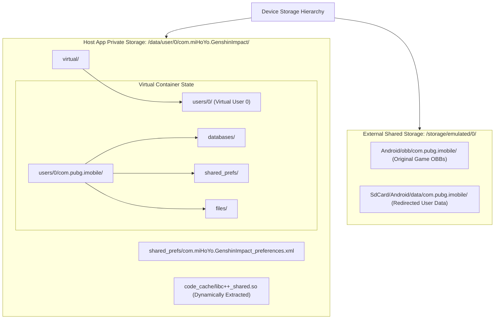

# Data Storage & Filesystem Architecture

## 1. Persistent Storage Overview

ExoraLoader utilizes three persistent data storage mechanisms:
1. **Host SharedPreferences (XML key-value store)** for application settings and user authorization tokens.
2. **Virtual Package Registry (SQLite / Serialized XML)** for tracking virtualized applications installed inside BlackBox.
3. **Virtual File System (VFS Directory Hierarchy)** for isolating guest data and expansion assets.



---

## 2. SharedPreferences Key Catalog

### 2.1. Host UI & Licensing Settings
File Path: `/data/user/0/com.miHoYo.GenshinImpact/shared_prefs/com.miHoYo.GenshinImpact_preferences.xml`

| Key Name | Type | Default Value | Description |
| :--- | :--- | :--- | :--- |
| `license_key` | String | `""` | The active software license key entered by the user in `LogAct`. |
| `license_expiry` | Long | `0L` | Epoch timestamp (milliseconds) when current subscription expires. |
| `hide_esp` | Boolean | `false` | Reflects state of `switchHideEsp`. When `true`, enables overlay window protection. |
| `last_target_pkg`| String | `"com.pubg.imobile"` | Package identifier of the most recently executed game. |
| `has_permissions`| Boolean | `false` | Cached status of runtime permission acquisition. |

---

### 2.2. Virtual Container Configuration
File Path: `/data/user/0/com.miHoYo.GenshinImpact/shared_prefs/v_box_config.xml`

| Key Name | Type | Value | Enforcement Description |
| :--- | :--- | :--- | :--- |
| `hide_root` | Boolean | `true` | When true, filters `/system/bin/su` and root properties from guest libc checks. |
| `hide_xposed` | Boolean | `true` | When true, hooks `ClassLoader` and `Throwable` to strip Xposed/LSPosed frames. |
| `enable_daemon` | Boolean | `true` | Controls whether `com.believeesp.core.DaemonService` monitors child PIDs. |

---

## 3. BlackBox Package Database Schema

BlackBox maintains an internal package registry that mimics the Android OS package database.

```sql
-- Conceptual Schema of the internal virtual package store
CREATE TABLE IF NOT EXISTS virtual_packages (
    package_name TEXT PRIMARY KEY NOT NULL,
    version_code INTEGER NOT NULL,
    version_name TEXT NOT NULL,
    apk_path TEXT NOT NULL,
    data_dir TEXT NOT NULL,
    install_time INTEGER NOT NULL,
    user_id INTEGER NOT NULL DEFAULT 0
);

CREATE TABLE IF NOT EXISTS virtual_permissions (
    id INTEGER PRIMARY KEY AUTOINCREMENT,
    package_name TEXT NOT NULL,
    permission_name TEXT NOT NULL,
    granted INTEGER NOT NULL DEFAULT 1,
    FOREIGN KEY(package_name) REFERENCES virtual_packages(package_name)
);
```

---

## 4. Virtual File System Layout

### 4.1. Guest Game Private Data
- When `com.pubg.imobile` executes standard file queries for its data directory (`Context.getDataDir()`), BlackBox redirects the request:
  $$\text{Real Target Path} = \texttt{/data/user/0/com.miHoYo.GenshinImpact/virtual/users/0/com.pubg.imobile/}$$

### 4.2. Unreal Engine Asset Caching
- Battle Royale titles built on Unreal Engine 4 write persistent shadow caches, pak files, and shader cache blobs to external storage.
- Standard Path: `/storage/emulated/0/Android/data/com.pubg.imobile/files/UE4Game/...`
- Intercepted Path: `/storage/emulated/0/SdCard/Android/data/com.pubg.imobile/files/UE4Game/...`
- **Purpose:** Avoids triggering Android 11+ Scoped Storage restrictions on the system `/Android/data/` folder.

### 4.3. Expansion OBB Path Handling
- Expansion assets (`main.xxxxx.com.pubg.imobile.obb`) must remain accessible in read-only mode.
- In `MAct.startDownloadAndLoadFlow()`, the loader inspects the public `/storage/emulated/0/Android/obb/com.pubg.imobile/` directory.
- The path is either mirrored into the virtual storage path or bound via libc hook to satisfy the Unreal Engine OBB mounting routine.

