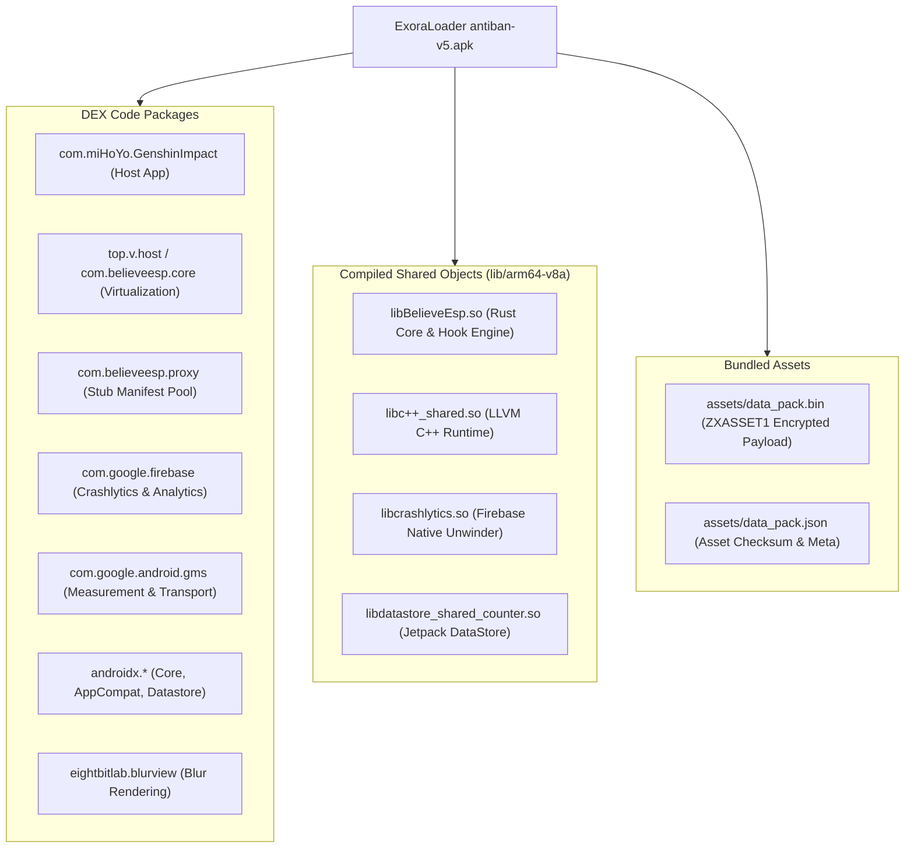

# Dependency & Package Inventory

## 1. Overview of Bundled Software Components

ExoraLoader is assembled from a combination of compiled Java/Kotlin bytecode packages (split across multi-DEX archives), native shared ELF libraries (`arm64-v8a`), and encrypted asset archives.

---

## 2. Java / Kotlin Package Breakdown

| Package Name | Origin / Library | Architectural Purpose |
| :--- | :--- | :--- |
| `com.miHoYo.GenshinImpact` | Custom Application | Main entry point, host activities (`LogAct`, `MAct`), JNI bridge (`ContainerLinkHandler`), and IPC receiver (`DiagnosticsReceiver`). |
| `top.v.host.*` | BlackBox (niunaijun) | Core virtualization framework: Binder proxies, system service hooking (`AMS`, `PMS`), and obfuscated string tables (`nc1`, `ox1`). |
| `com.believeesp.core.*` | BlackBox Extension | Daemon services (`DaemonService`), system call providers (`SystemCallProvider`), and process isolation logic. |
| `com.believeesp.proxy.*` | BlackBox Manifest Pool | Pre-allocated stub components (`ProxyActivity$P0..P24`, `ProxyService$P0..P24`, `ProxyContentProvider$P0..P24`). |
| `com.google.firebase.crashlytics` | Google Firebase | Uncaught Java exception collection and native crash telemetry dispatch. |
| `com.google.firebase.analytics` | Google Firebase | Device event tracking and telemetry. |
| `com.google.android.datatransport`| Google Play Services | Reliable background data transport pipeline for telemetry events. |
| `androidx.appcompat.*` | Android Jetpack | Modern Android UI compatibility layer. |
| `androidx.datastore.*` | Android Jetpack | Key-value data persistence engine. |
| `com.google.android.material.*` | Google Material Design | UI widgets, cards, text input fields, and material buttons. |
| `eightbitlab.blurview` | eightbitlab | Hardware-accelerated Gaussian blur implementation (`RenderScriptBlur`). |

---

## 3. Native Compiled Shared Libraries (`lib/arm64-v8a`)

All binaries are compiled strictly for the **64-bit ARM architecture (`arm64-v8a` / AArch64)**. The application does not include 32-bit (`armeabi-v7a`) or x86 libraries, reflecting the exclusive 64-bit requirement of modern battle royale games.

| Binary Name | File Size | Toolchain / Origin | Technical Role & Exported Symbols |
| :--- | :---: | :--- | :--- |
| **`libBelieveEsp.so`** | 1,402,680 B | Rust (LLVM Clang) | Core native engine. Exports `JNI_OnLoad`. Contains inline hook engine, memory scanners, overlay drawing loop, and native crash reporter. |
| **`libc++_shared.so`** | 1,235,920 B | LLVM Project | Standard C++ runtime library supporting native components. Dynamically extracted by `BoxApplication` to `code_cache/`. |
| **`libcrashlytics.so`** | 124,536 B | Google Firebase | Native unwinder and signal interceptor for capturing native thread call stacks. |
| **`libdatastore_shared_counter.so`**| 14,248 B | Google Android Jetpack | Implements atomic counter synchronization for AndroidX DataStore. |

---

## 4. Encrypted Assets & Data Packs

| Asset Path | Size | Format | Purpose |
| :--- | :---: | :--- | :--- |
| `assets/data_pack.bin` | 4,240,499 B | `ZXASSET1` Container | Deflate-compressed binary payload containing supplementary native payloads and configuration data loaded dynamically by `libBelieveEsp.so`. |
| `assets/data_pack.json`| 184 B | JSON Manifest | Contains cryptographic SHA-256 checksum and version metadata for validating `data_pack.bin`. |

