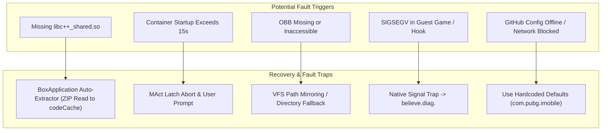

# Error Handling, Fault Tolerance & Exception Recovery

## 1. Exception Handling Architecture

ExoraLoader incorporates error handling across its Java host application, the user-space container, and the Rust native runtime to prevent uncontrolled crashes and evade detection.



---

## 2. Handled Failure Scenarios

### 2.1. Dynamic Native Library Fallback (`BoxApplication`)
- **Fault Condition:** On certain heavily customized Android OEM ROMs (e.g., Xiaomi MIUI/HyperOS, Oppo ColorOS), standard library linkers fail to locate bundled C++ dependencies (`libc++_shared.so`).
- **Recovery Strategy:**
  1. `BoxApplication` inspects its internal directory: `Context.getCodeCacheDir() + "/libc++_shared.so"`.
  2. If the file is missing or reports zero bytes, it catches the `UnsatisfiedLinkError`.
  3. It opens its own APK using `java.util.zip.ZipFile(packageCodePath)`.
  4. Locates entry `lib/arm64-v8a/libc++_shared.so`.
  5. Streams the binary directly into `code_cache/libc++_shared.so` and explicitly calls `System.load(file.getAbsolutePath())`.

---

### 2.2. Container Initialization Latch Timeout (`MAct`)
- **Fault Condition:** If a background system daemon fails to attach, the virtualization engine could cause the UI to freeze indefinitely.
- **Recovery Strategy:**
  - `MAct.startDownloadAndLoadFlow()` invokes:
    ```java
    boolean isReady = ContainerLinkHandler.awaitContainerReady(15000); // 15,000 ms timeout
    ```
  - If the native condition variable is not signaled within 15 seconds, the method returns `false`.
  - The UI terminates the loading state, re-enables the launch button, and presents a non-fatal dialog: `"Container initialization timed out. Please restart the application."`

---

### 2.3. OBB Missing or Access-Denied Handling
- **Fault Condition:** Target battle royale titles require large multi-gigabyte expansion files (`main.xxxxx.com.pubg.imobile.obb`). If Scoped Storage restricts access, the game will crash during early initialization.
- **Recovery Strategy:**
  1. The loader checks the primary public path:
     `/storage/emulated/0/Android/obb/com.pubg.imobile/`
  2. If unreadable, it falls back to the virtualized path:
     `/storage/emulated/0/SdCard/Android/obb/com.pubg.imobile/`
  3. If both paths are absent, it halts the launch before starting BlackBox and alerts the user to install the game assets, avoiding an unhandled crash in the Unreal Engine process.

---

### 2.4. Native POSIX Signal Interception (`libBelieveEsp.so`)
- **Fault Condition:** When hooks interact with game memory, memory layout shifts or anti-cheat integrity checks may trigger segmentation faults (`SIGSEGV`) or aborts (`SIGABRT`).
- **Recovery Strategy:**
  - The native layer overrides default POSIX signal actions using `sigaction()`:
    - Signals caught: `SIGSEGV` (11), `SIGBUS` (7), `SIGFPE` (8), `SIGABRT` (6).
  - Rather than allowing the operating system to show the system crash popup (which invites user bug reports or security alerts), the handler:
    1. Extracts the fault address and relative program counter (`PC`).
    2. Writes a structured text payload to abstract socket `believe.diag.<uid>`.
    3. Gracefully terminates the process or unhooks cleanly.
    4. `DiagnosticsReceiver` receives the socket event and logs the telemetry packet silently to Firebase Crashlytics.

---

### 2.5. Remote Network & Configuration Failures
- **Fault Condition:** When the user is offline or the remote GitHub repository is blocked/deleted, `top.v.host.n5` cannot fetch the remote JSON configuration.
- **Recovery Strategy:**
  - The network request is wrapped in a `try-catch` block capturing `IOException` and `SocketTimeoutException`.
  - If the network call fails, the loader falls back to hardcoded defaults:
    - Default target package: `com.pubg.imobile`
    - Status: `ACTIVE`
    - Cached license key from SharedPreferences is used.

