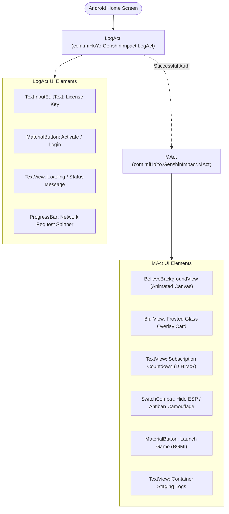
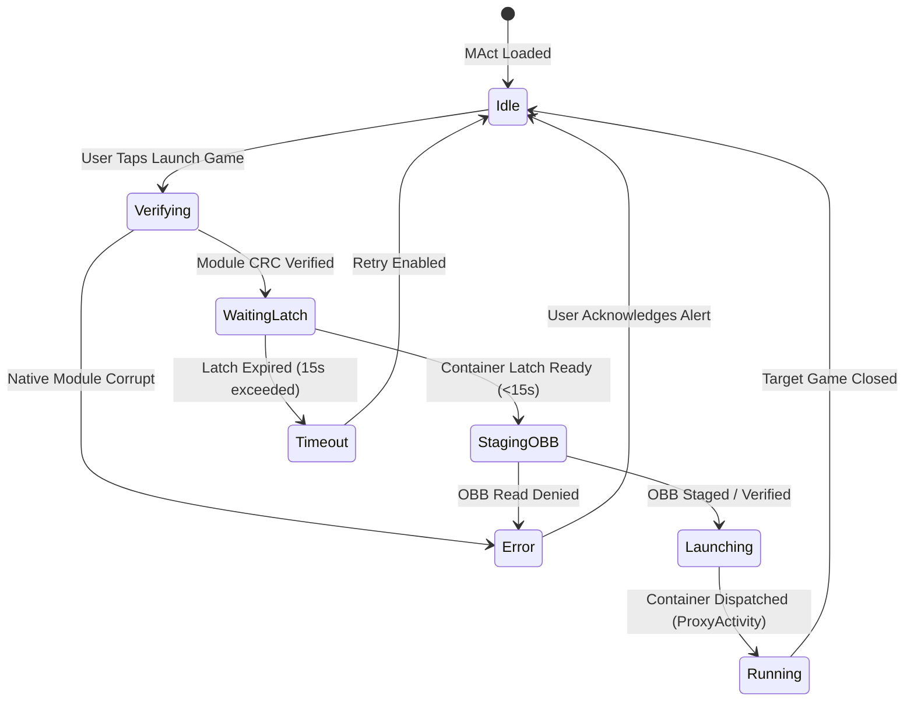

# Frontend Architecture & UI Logic

## 1. UI Overview & Technology Stack

The graphical user interface of ExoraLoader is structured as a native Android application using XML-based declarative layouts, Material Components, and custom graphics views. It implements a dark-mode frosted glass ("glassmorphism") design language.

### Key Frontend Components & Libraries:
- **`eightbitlab.blurview.BlurView`**: Real-time hardware-accelerated background blur for glassmorphism panels.
- **`com.google.android.material`**: Material Design text fields, switches, and elevated cards.
- **`androidx.appcompat.app.AppCompatActivity`**: Base activity framework.
- **`BelieveBackgroundView`**: Custom Android `View` that renders animated canvas graphics behind the frosted glass dashboard.

---

## 2. Activity Hierarchy



---

## 3. Screen Breakdown & UI Logic

### 3.1. Authentication Gateway (`LogAct`)

- **Class:** `com.miHoYo.GenshinImpact.LogAct`
- **Layout Reference:** `R.layout.activity_log`
- **Primary Responsibilities:**
  1. Present the user with an activation key input dialog if not previously logged in.
  2. Block execution if active VPN connections are detected (`isVpnActive()`).
  3. Orchestrate runtime permission requests before allowing navigation to `MAct`.

#### Key UI Workflow in `LogAct`:
1. **`onCreate()` Initialization:**
   - Reads `license_key` from private SharedPreferences (`com.miHoYo.GenshinImpact_preferences`).
   - If a valid key exists, sets the input field text automatically and triggers silent verification.
2. **Permission Request Flow:**
   - On cold start, checks for standard runtime permissions (`READ_EXTERNAL_STORAGE`, `WRITE_EXTERNAL_STORAGE`, `RECORD_AUDIO`).
   - On devices running Android 11+ (API 30+), checks `Environment.isExternalStorageManager()`.
   - If permissions are missing, displays a system permission dialog or directs the user to `Settings.ACTION_MANAGE_ALL_FILES_ACCESS_PERMISSION`.
3. **Activation Button Action (`btnActivate.setOnClickListener`):**
   - Disables button and displays loading spinner.
   - Invokes backend authentication via `SdkActivation` (or custom OkHttp endpoint).
   - On success: Saves key, writes license expiration timestamp to SharedPreferences, and fires an explicit Intent to start `MAct`.
   - On failure: Restores button interactivity and shows a `Toast` or `Snackbar` with the server error message.

---

### 3.2. Main Virtualization Dashboard (`MAct`)

- **Class:** `com.miHoYo.GenshinImpact.MAct`
- **Layout Reference:** `R.layout.activity_m`
- **Primary Responsibilities:**
  1. Render the glassmorphism control panel.
  2. Display active subscription remaining time via an asynchronous countdown timer.
  3. Provide toggles for cheat overlay concealment (`switchHideEsp`).
  4. Initiate the game staging, OBB verification, and container launch sequence.

#### 1. Frosted Glass Setup (`BlurView`):
Inside `MAct.onCreate()`, the application configures `eightbitlab.blurview.BlurView`:
```java
// Conceptual reconstruction from DEX bytecode
BlurView blurView = findViewById(R.id.blur_card);
View decorView = getWindow().getDecorView();
ViewGroup rootView = decorView.findViewById(android.R.id.content);
Drawable windowBackground = decorView.getBackground();

blurView.setupWith(rootView, new RenderScriptBlur(this))
    .setFrameClearDrawable(windowBackground)
    .setBlurRadius(15.0f)
    .setBlurAutoUpdate(true);
```

#### 2. Subscription Countdown Timer:
- Uses `android.os.CountDownTimer` to compute real-time remaining license duration:
  $$\text{Days} = \frac{\Delta t}{86400000}, \quad \text{Hours} = \frac{\Delta t \pmod{86400000}}{3600000}, \quad \dots$$
- Updates `tvSubscriptionCountdown.setText(String.format("%02dd %02dh %02dm %02ds", days, hours, mins, secs))`.
- When the timer reaches 0, the session is invalidated, `MAct` is finished, and the user is redirected to `LogAct`.

#### 3. ESP Concealment Switch (`switchHideEsp`):
- Controls overlay visibility and screen-recorder evasion:
  - When enabled, invokes `ContainerLinkHandler.setEspConcealed(true)`.
  - Sets `WindowManager.LayoutParams.FLAG_SECURE` on the overlay window surface to turn captured screenshots or screen recordings black.

#### 4. Launch Game Button (`btnLaunch`):
- Validates that the default package `com.pubg.imobile` is installed or ready in the virtual container.
- Transitions UI to a loading state: updates status text (`"Checking OBB..."`, `"Waiting for container..."`, `"Starting virtual environment..."`).
- Dispatches execution to background thread `startDownloadAndLoadFlow()`.

---

## 4. UI State Machine



