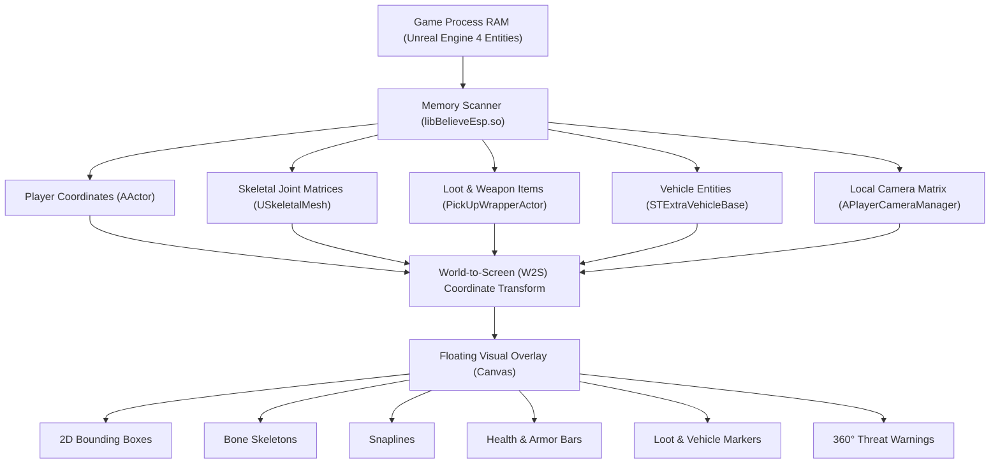
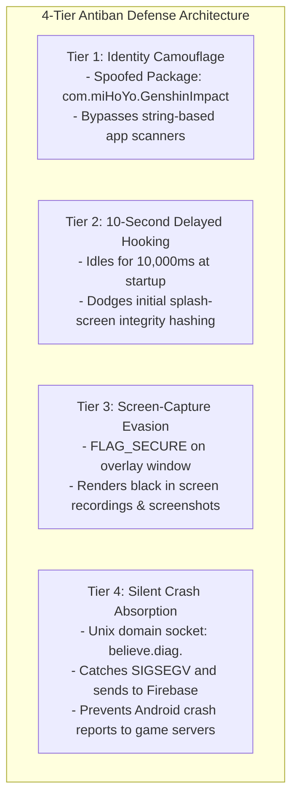

# ExoraLoader: How It Works & Complete Mod Features Guide

## 1. Executive Summary & Core Concept

**ExoraLoader** (`ExoraLoader antiban-v5.apk`) is an Android gaming virtualization container and overlay engine. It is packaged under the disguised package name **`com.miHoYo.GenshinImpact`** (borrowed from the legitimate game *Genshin Impact*) to bypass package name blacklists used by mobile anti-cheat engines.

Its primary function is to run mobile Battle Royale games (specifically **Battlegrounds Mobile India / BGMI** and **PUBG Mobile**) inside a private **user-space virtual sandbox** (based on **BlackBox**), intercepting the game's execution, reading game memory from RAM, and drawing real-time visual modifications (ESP) on a transparent overlay screen—**all without requiring root privileges, Magisk, or KernelSU**.

---

## 2. The Architectural Analogy (The "Dual-Room" Concept)

To understand how ExoraLoader works without root access, consider the **Dual-Room Analogy**:

```
┌────────────────────────────────────────────────────────────────────────┐
│                              ANDROID DEVICE                            │
│                                                                        │
│   ┌────────────────────────────────────────────────────────────────┐   │
│   │   TRANSPARENT FLOATING GLASS (SYSTEM_ALERT_WINDOW Overlay)     │   │
│   │   - Draws: 2D Player Boxes, Skeletons, Health, Items, Distance │   │
│   └────────────────────────────────────────────────────────────────┘   │
│                                   ▲                                    │
│                    Direct In-Process Memory Reading                    │
│                                   │                                    │
│   ┌────────────────────────────────────────────────────────────────┐   │
│   │   VIRTUAL SANDBOX (BlackBox Container Layer)                   │   │
│   │   ┌────────────────────────────────────────────────────────┐   │   │
│   │   │   Target Game: Battlegrounds Mobile India (BGMI)       │   │   │
│   │   │   - Thinks it is running on a normal, unmodified phone │   │   │
│   │   │   - Anti-cheat scanners see clean environment          │   │   │
│   │   └────────────────────────────────────────────────────────┘   │   │
│   └────────────────────────────────────────────────────────────────┘   │
└────────────────────────────────────────────────────────────────────────┘
```

1. **Normal Android Game Execution:** The game runs directly on the device. An anti-cheat security scanner (e.g., Tencent Anogs / Krafton MTP) checks the system for root binaries (`/system/bin/su`), dangerous hooking frameworks (Xposed, Frida), and suspicious processes.
2. **Execution Inside ExoraLoader:**
   - ExoraLoader creates a **virtualized sandbox** inside its own process.
   - The game is launched inside this sandbox. Because both the game and the mod engine share the **same Linux Process ID (PID) and User ID (UID)**, the mod engine can read game memory legally without needing root permissions.
   - Meanwhile, ExoraLoader renders a **hardware-accelerated transparent overlay** on top of the phone screen that the game cannot detect.

---

## 3. Complete Mod Features Catalog

The visual modifications provided by the native engine (`libBelieveEsp.so`) are categorized as **ESP (Extra Sensory Perception)**. In Unreal Engine 4 mobile games, the positions of nearby players, vehicles, and loot items are loaded into device RAM so the engine can render them when they enter the camera's viewport. The mod engine extracts these coordinates and renders visual indicators over them.



### Detailed Breakdown of Features:

| Mod Feature | Visual Output on Screen | Technical Implementation & Working Logic |
| :--- | :--- | :--- |
| **1. Player Box ESP** | A rectangular 2D bounding box drawn around enemy players through walls, terrain, and structures. | Reads the enemy actor's 3D root location $(X, Y, Z)$ and height from the game's `AActor` entity in RAM. Applies World-to-Screen projection to compute 2D screen coordinates and renders a bounding rectangle. |
| **2. Skeleton / Bone ESP** | A stick-figure skeleton drawn over the enemy that bends, crouches, jumps, and animates in sync with their movements. | Accesses Unreal Engine's `USkeletalMeshComponent` inside the enemy actor. Reads transformation matrices for key bones (Head, Neck, Spine, Pelvis, Left/Right Shoulders, Elbows, Hands, Knees, Feet) and connects the projected coordinates with lines. |
| **3. Line / Snapline ESP** | A straight reference line pointing from a screen origin (top or bottom center) directly to each enemy. | Draws a 2D line connecting a static screen coordinate (e.g. $X = \frac{\text{Width}}{2}, Y = 0$) to the enemy's projected head location $(X_{\text{screen}}, Y_{\text{screen}})$. |
| **4. Distance & Player Metadata** | Text displaying enemy player nickname, team number, and distance in meters (e.g., `Player_01 [145m]`). | Calculates Euclidean 3D distance between local player $(X_1, Y_1, Z_1)$ and enemy $(X_2, Y_2, Z_2)$: <br>$$\text{Distance (m)} = \frac{\sqrt{(X_2 - X_1)^2 + (Y_2 - Y_1)^2 + (Z_2 - Z_1)^2}}{100}$$ Reads the player's UTF-8 name string from the `PlayerState` structure. |
| **5. Health & Armor Bar** | A green-to-red dynamic health bar and armor indicators above the enemy's head. | Reads the health float value (`Health`, `HealthMax`) from the character component. Dynamically renders a proportional progress bar that turns red as HP decreases. |
| **6. Loot & Weapon ESP** | Distinct glowing labels and icons for valuable ground items (Flare Guns, AWM, M416, Level 3 Helmets/Vests, 7.62mm Ammo, Medkits). | Scans the game's actor list for `PickUpWrapperActor` instances. Matches item IDs against an internal item hash dictionary and renders labels with distance tags. |
| **7. Vehicle ESP** | Labels indicating nearby vehicles (Buggy, Dacia, UAZ, Motorbike, Air Drop Boat) along with fuel and health levels. | Queries vehicle actor classes (`STExtraVehicleBase`) and displays their locations up to 400+ meters away through terrain. |
| **8. 360° Threat Alert Indicator** | Directional arrows or warning numbers around the screen borders when an enemy is behind or aiming at you off-screen. | Computes the dot product and angle between the local camera's forward vector and the enemy's position vector. If the enemy falls outside the camera's Field of View (FOV), a directional arrow is rendered along the screen edge pointing toward them. |

---

## 4. The Mathematical Foundation: World-to-Screen (W2S)

Games render in **3D space** $(X, Y, Z)$, but mobile screens display in **2D pixels** $(X, Y)$. To draw a box around a player 150 meters away, the engine converts 3D world coordinates into 2D screen coordinates using the **World-to-Screen algorithm**.

```mermaid
flowchart LR
    World["3D World Point: (X, Y, Z)"] --> MatrixMult["Multiply by View Projection Matrix (4x4)"]
    MatrixMult --> Clip["Clip Space Coordinates: (X_clip, Y_clip, Z_clip, W)"]
    Clip --> PerspectiveDiv["Perspective Division: Divide by W"]
    PerspectiveDiv --> NDC["Normalized Device Coordinates: (-1.0 to +1.0)"]
    NDC --> ViewportMap["Viewport Mapping to Screen Pixels"]
    ViewportMap --> Screen["2D Screen Coordinates: (X_pixel, Y_pixel)"]
```



### Mathematical Steps:

1. **Camera Matrix Extraction:** The native engine reads the 3D camera location, camera rotation (Pitch, Yaw, Roll), and Field of View (FOV) from the game's `APlayerCameraManager` object.
2. **Matrix Transformation:**
   $$\begin{bmatrix} X_{\text{clip}} \\ Y_{\text{clip}} \\ Z_{\text{clip}} \\ W \end{bmatrix} = \mathbf{M}_{\text{view-projection}} \times \begin{bmatrix} X_{\text{world}} \\ Y_{\text{world}} \\ Z_{\text{world}} \\ 1 \end{bmatrix}$$
3. **Clip Test:** If $W < 0.001$, the target is located behind the player's camera lens and is not drawn.
4. **Perspective Division & Screen Mapping:**
   $$X_{\text{screen}} = \left(\frac{X_{\text{clip}}}{W} + 1.0\right) \times \frac{\text{Display Width}}{2}$$
   $$Y_{\text{screen}} = \left(1.0 - \frac{Y_{\text{clip}}}{W}\right) \times \frac{\text{Display Height}}{2}$$

---

## 5. The "Antiban" System: 4-Tier Evasion Mechanics

ExoraLoader deploys four distinct evasion mechanisms to prevent anti-cheat detection:



### 1. Identity Camouflage (`com.miHoYo.GenshinImpact`)
Anti-cheat engines scan installed apps and running processes (`/proc/self/cmdline`) for blacklisted cheat keywords ("loader", "mod", "virtual", "cheat"). ExoraLoader declares its package name as **`com.miHoYo.GenshinImpact`**. When the anti-cheat asks Android what host application is running, the OS identifies it as *Genshin Impact*, bypassing simple blacklist filters.

### 2. The 10-Second Delayed Injection Gate
Anti-cheat engines (`libanogs.so`, `libTssSec.so`) execute heavy memory hashing, `.text` section checksumming, and page protection scans during the game's splash screen loading sequence.
- ExoraLoader invokes `scheduleDelayedInjection(10000)`.
- The native thread **sleeps for exactly 10 seconds** (`usleep(10000000)`).
- It applies memory hooks only after the game transitions to the main lobby and the anti-cheat finishes its intensive startup integrity scan.

### 3. Screen-Capture & Recording Evasion (`FLAG_SECURE`)
When the user activates the **"Hide ESP"** toggle (`switchHideEsp`) on the dashboard:
- The app applies `WindowManager.LayoutParams.FLAG_SECURE` to the floating overlay window.
- The Android WindowManager enforces that all screen capture, screen recording, and casting APIs capture a completely blank/black frame over the overlay coordinates, concealing the visuals from in-game reporting or stream recordings.

### 4. Silent Crash Absorption (Local Unix Domain Socket)
If an invalid memory pointer is dereferenced, normal Android applications trigger a fatal segmentation fault (`SIGSEGV`), prompting the OS to display a crash dialog and transmit a diagnostic report to Krafton/Tencent servers.
- ExoraLoader registers custom signal handlers via `sigaction()` for `SIGSEGV`, `SIGBUS`, and `SIGABRT`.
- When a crash occurs, it traps the signal, formats a compact backtrace, streams it over an abstract Linux socket (`believe.diag.<uid>`), and routes it to **Firebase Crashlytics** without triggering the Android system crash dialog.

---

## 6. End-to-End Application Execution Flow

```
[ User Opens ExoraLoader ]
            │
            ▼
1. BoxApplication initializes BlackBox virtualization container
   - Sets hideRoot = true, hideXposed = true
   - Extracts libc++_shared.so to internal code_cache/
            │
            ▼
2. LogAct Gateway verifies environment
   - isVpnActive() check: Halts if VPN or proxy is detected
   - Verifies license key via remote activation server
   - Fetches remote config from GitHub (target package, status)
            │
            ▼
3. MAct Dashboard configures game launch
   - Renders frosted glass UI (eightbitlab BlurView)
   - Starts subscription countdown timer
   - User toggles "Hide ESP" and taps "Launch Game"
            │
            ▼
4. ContainerLinkHandler prepares launch
   - Awaits container ready latch (15-second timeout)
   - Discovers & mirrors OBB expansion files (/Android/obb/com.pubg.imobile/)
   - Prepares native memory allocation for target package
            │
            ▼
5. Virtual Game Starts Inside Sandbox
   - BlackBox allocates an unused stub (ProxyActivity$P0)
   - Target game launches inside the virtual container
   - Game anti-cheat performs initial memory hashing (Sees clean state)
            │
            ▼
6. 10-Second Timer Completes in libBelieveEsp.so
   - Native worker thread wakes up
   - Resolves entity lists and camera matrices in libUE4.so
   - Applies World-to-Screen matrix transforms
            │
            ▼
7. Floating Visual Overlay Renders ESP
   - Draws Player Boxes, Skeletons, Health Bars, and Loot markers
```

---

## 7. Cross-Reference Documentation

For detailed source code inspections, bytecodes, and disassemblies, refer to the other documents in the project:

- [**`ARCHITECTURE.md`**](file:///E:/Loader/ARCHITECTURE.md) — Host vs. container separation and Binder service hooking.
- [**`APPLICATION_FLOW.md`**](file:///E:/Loader/APPLICATION_FLOW.md) — Comprehensive lifecycle and sequence flows.
- [**`AUTHENTICATION_SECURITY.md`**](file:///E:/Loader/AUTHENTICATION_SECURITY.md) — String decryption, Feistel cipher (`ox1.t`), and anti-analysis checks.
- [**`CORE_ALGORITHMS.md`**](file:///E:/Loader/CORE_ALGORITHMS.md) — Mathematical formulas and Python implementations of the string and asset decoders.
- [**`DECOMPILATION_REPORT.md`**](file:///E:/Loader/decompiled/analysis/decompilation_report.md) — Inventory of all 6,228 Smali classes, 5,344 Java source files, and 7 native libraries.

