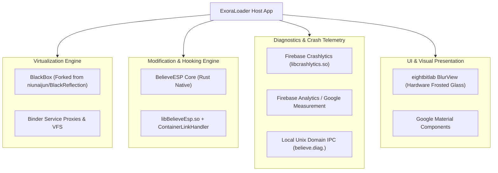

# Third-Party Integrations & External Services

## 1. Overview of Integrated Systems

ExoraLoader integrates several open-source libraries, commercial telemetry SDKs, and proprietary native modules.

---

## 2. Integrated Frameworks

### 2.1. BlackBox Virtualization Core
- **Original Author:** niunaijun (BlackReflection)
- **Repackaged Namespaces:** `top.v.host.*`, `com.believeesp.core.*`, `com.believeesp.proxy.*`
- **Role:** Provides the entire user-space virtualization layer allowing uninstalled APKs to run in an isolated sandbox.
- **Modifications Identified:**
  - Repackaged stub component pool into `com.believeesp.proxy.*`.
  - Added custom IPC bridge to synchronize with the `ContainerLinkHandler` latch.
  - Inlined root/Xposed hiding flags directly into the base initialization sequence.

---

### 2.2. BelieveESP Engine
- **Language / Toolchain:** Rust, compiled with LLVM Clang for ARM64 (`aarch64-linux-android`).
- **Binary:** `lib/arm64-v8a/libBelieveEsp.so` (1.4 MB)
- **Role:**
  - JNI initialization and integrity verification.
  - In-game memory scanning and entity tracking.
  - Overlay rendering and screen concealment via `FLAG_SECURE`.
  - Native signal catching (`SIGSEGV`, `SIGBUS`, `SIGABRT`) and crash forwarding to `believe.diag.<uid>`.

---

### 2.3. Google Firebase & Crashlytics
- **Java Packages:** `com.google.firebase.crashlytics.*`, `com.google.firebase.analytics.*`
- **Native Component:** `lib/arm64-v8a/libcrashlytics.so`
- **Configuration Provider:** `com.google.firebase.provider.FirebaseInitProvider` (in `AndroidManifest.xml`)
- **Role:**
  - Uncaught exception logging for host Java crashes.
  - Captures native crash reports routed from guest games via the `FieldDiagnostics` class.
  - Pushes custom crash keys:
    - `"fault_address"`
    - `"program_counter"`
    - `"signal_name"`
    - `"relative_pc"`

---

### 2.4. eightbitlab BlurView
- **Repository:** `eightbitlab/BlurView`
- **Classes:** `eightbitlab.blurview.BlurView`, `eightbitlab.blurview.RenderScriptBlur`
- **Role:**
  - Renders real-time hardware-accelerated frosted glass effects for the `MAct` control dashboard.
  - Automatically captures background views (`BelieveBackgroundView`) and applies a 15px Gaussian blur radius.

---

### 2.5. Android Jetpack & Google Play Services
- **DataStore:** `androidx.datastore` (incorporating `libdatastore_shared_counter.so`).
- **Google Play Install Referrer:** `com.google.android.finsky.permission.BIND_GET_INSTALL_REFERRER_SERVICE`.
- **Google DataTransport:** `com.google.android.datatransport` for background event dispatching.

---

## 3. Remote Endpoints & Network Services

| Endpoint / Domain | Protocol | Component | Purpose |
| :--- | :--- | :--- | :--- |
| `raw.githubusercontent.com` | HTTPS | `top.v.host.n5` | Fetches master configuration JSON (version, announcements, kill-switch). |
| `firebaseinstallations.googleapis.com` | HTTPS | Firebase SDK | Firebase device installation token registration. |
| `crashlyticsreports-pa.googleapis.com`| HTTPS | Crashlytics SDK | Uploads native and Java crash dumps. |
| Licensing Server API | HTTPS | `LogAct` / `SdkActivation` | Verifies user activation key and retrieves subscription expiry timestamp. |

