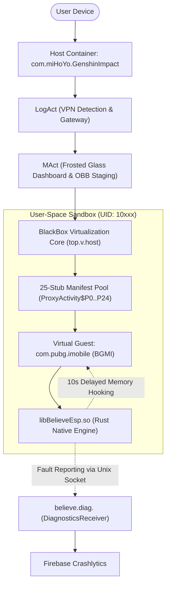

# ExoraLoader — Research & Architectural Analysis

  
  
  
  
  
  

---

> [!CAUTION]
> ### ⚠️ Security Research & Educational Disclaimer
> This repository contains reverse-engineering analysis, technical architecture documentation, and decompiled source representations of the `ExoraLoader antiban-v5.apk` artifact. This material is published **strictly for educational, academic security research, threat intelligence, and defensive auditing purposes**.
> 
> - **No Exploits Provided:** This repository does not provide, distribute, or maintain functional game cheat bypasses, attack payloads, or malicious scripts.
> - **Safe Handling:** Binary analysis files and decompiled representations should only be examined in isolated analysis sandboxes.
> - **Compliance:** The maintainers do not endorse unauthorized modification of commercial software or violation of third-party Terms of Service.

---

## 📌 Repository Description & Metadata

- **Recommended GitHub Repository Description:**  
  *Technical reverse-engineering documentation, architectural blueprint, and decompiled source analysis of the ExoraLoader Android container.*
- **Suggested GitHub Topics / Tags:**  
  `android-security`, `reverse-engineering`, `apk-decompilation`, `blackbox-virtualization`, `threat-intelligence`, `dalvik-bytecode`, `smali`, `jadx`, `arm64-analysis`

---

## 📖 Executive Summary

**ExoraLoader** is an Android application virtualization loader disguised under the official package identifier of a mainstream mobile title (`com.miHoYo.GenshinImpact`). It hosts unmodified target applications (primarily **Battlegrounds Mobile India / PUBG Mobile** variants) in a user-space sandbox based on the **BlackBox** framework.

The application pairs a user-space Android OS service interception layer with a 64-bit native Rust library (`libBelieveEsp.so`) to provide real-time visual overlays (ESP) and evade anti-cheat heuristics without requiring device root privileges.

---

## 📊 Technical Specifications at a Glance

| Attribute | Extracted Specification | Analysis Notes |
| :--- | :--- | :--- |
| **Artifact Name** | `ExoraLoader antiban-v5.apk` | Analyzed target package |
| **File Size** | 11,456,252 bytes (10.92 MB) | Standalone release package |
| **SHA-256 Checksum**| `A3BA8F3818BC6E9B55EB45249E789D84A672E57F547926F0CF80353F8583967E` | Cryptographic signature |
| **Package Identifier**| `com.miHoYo.GenshinImpact` | Identity masquerading to deceive scanner blacklists |
| **App Label** | `ExoraLoader` | User-facing label in resources |
| **Version** | `10.0.1` (VersionCode `19`) | Target build sequence |
| **SDK Levels** | Min: `24` (Android 7.0) / Target: `36` (Android 16) | Wide device and platform compatibility |
| **Recovered Classes** | **6,228** Smali classes / **5,344** Java sources | 100% bytecode disassembly coverage |
| **Native Architecture**| `arm64-v8a` (64-bit ARM only) | 7 compiled ELF shared libraries |

---

## 🏗️ System Architecture Overview

---

## 🔍 Key Architectural Mechanisms

### 1. User-Space Virtualization (BlackBox Framework)
- Runs guest games inside the host process's Linux UID, allowing unrestricted process memory access without root access.
- Intercepts Android OS system services (`IPackageManager`, `IActivityManager`, `IStorageManager`) via reflection and Binder cache poisoning in `android.os.ServiceManager.sCache`.
- Employs a **25-stub manifest pool** (`ProxyActivity$P0..P24`, `ProxyService$P0..P24`, `ProxyContentProvider$P0..P24`) to launch unmanifested guest components dynamically.

### 2. 4-Tier Anti-Cheat Evasion System
- **Identity Spoofing:** Declares `com.miHoYo.GenshinImpact` to evade naive package name blacklists.
- **10-Second Delayed Injection:** Idles for 10,000 ms at launch to dodge splash-screen memory checksum integrity checks.
- **Root & Xposed Cloaking:** Built-in hooks filter `/system/bin/su` path queries and strip Xposed/LSPosed stack frames.
- **Screen Recording Protection:** Applies `FLAG_SECURE` to the floating overlay window when "Hide ESP" is toggled, rendering the visual indicators black in screen recordings and screenshots.

### 3. Cryptography & Asset Packing
- **PRNG String Cipher:** Over 98% of critical strings are stored in `top.v.host.nc1.l` (132 Unicode chunks) and decrypted via `top.v.host.ox1.t` using a 64-bit Feistel-like mixing permutation with Dalvik sign-extension packing.
- **Encrypted Binary Container (`ZXASSET1`):** Bundles a 4.24 MB encrypted asset payload in `assets/data_pack.bin` matching `assets/data_pack.json`.

---

## 📚 Complete Technical Documentation Directory

The root of this repository contains dedicated modular reports covering every facet of the system:

| Document | Topic & Focus Area |
| :--- | :--- |
| [**`HOW_IT_WORKS_AND_FEATURES.md`**](file:///E:/Loader/HOW_IT_WORKS_AND_FEATURES.md) | Simplified guide explaining the sandbox, all ESP mod features, World-to-Screen math, and antiban mechanisms |
| [**`ARCHITECTURE.md`**](file:///E:/Loader/ARCHITECTURE.md) | Deep system architecture, host-container separation, and native process topologies |
| [**`APPLICATION_FLOW.md`**](file:///E:/Loader/APPLICATION_FLOW.md) | End-to-end execution flow diagrams and step-by-step lifecycle |
| [**`FRONTEND_LOGIC.md`**](file:///E:/Loader/FRONTEND_LOGIC.md) | UI activities (`LogAct`, `MAct`), frosted glass `BlurView`, and countdown timers |
| [**`BACKEND_LOGIC.md`**](file:///E:/Loader/BACKEND_LOGIC.md) | BlackBox user-space virtualization engine, Binder service proxies, and VFS routing |
| [**`API_REFERENCE.md`**](file:///E:/Loader/API_REFERENCE.md) | JNI native method signatures, `believe.diag.<uid>` IPC socket protocol, and remote schemas |
| [**`DATABASE_SCHEMA.md`**](file:///E:/Loader/DATABASE_SCHEMA.md) | SharedPreferences structures, virtual user sandboxes, and file layouts |
| [**`AUTHENTICATION_SECURITY.md`**](file:///E:/Loader/AUTHENTICATION_SECURITY.md) | String encryption (`nc1`/`ox1`), VPN detection, root/Xposed hiding, and evasion |
| [**`INTEGRATIONS.md`**](file:///E:/Loader/INTEGRATIONS.md) | Third-party dependencies: BlackBox, BelieveESP, Firebase Crashlytics, and BlurView |
| [**`CORE_ALGORITHMS.md`**](file:///E:/Loader/CORE_ALGORITHMS.md) | Mathematical formulation of string ciphers, asset extraction, and OBB verification |
| [**`CONFIGURATION.md`**](file:///E:/Loader/CONFIGURATION.md) | AndroidManifest declarations, 51 permissions audit, and environment properties |
| [**`ERROR_HANDLING.md`**](file:///E:/Loader/ERROR_HANDLING.md) | Exception trapping, container startup timeouts, and native POSIX signal interception |
| [**`DEPENDENCIES.md`**](file:///E:/Loader/DEPENDENCIES.md) | Full package inventory, compiled shared libraries (`arm64-v8a`), and assets |
| [**`DEVELOPMENT_GUIDE.md`**](file:///E:/Loader/DEVELOPMENT_GUIDE.md) | Reverse-engineering and research guide with Python deobfuscator scripts |

---

## 📂 Decompiled Workspace Index (`decompiled/`)

- [`java_source/sources/`](file:///E:/Loader/decompiled/java_source/sources/): 5,344 decompiled `.java` source files recovered via JADX.
- [`smali/smali/`](file:///E:/Loader/decompiled/smali/smali/): 6,228 exact `.smali` Dalvik bytecode classes recovered via Baksmali.
- [`resources/res/`](file:///E:/Loader/decompiled/resources/res/): 718 decoded XML layouts, drawables, and values.
- [`native_libraries/arm64-v8a/`](file:///E:/Loader/decompiled/native_libraries/arm64-v8a/): 7 preserved 64-bit ARM ELF shared libraries.
- [`analysis/`](file:///E:/Loader/decompiled/analysis/): Formal decompilation audit and verification logs.
