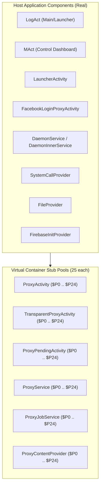

# Application Component Analysis

## 1. Manifest Component Overview

The application's decoded `AndroidManifest.xml` (52,207 bytes) registers **167 distinct Android application components**. The vast majority (150 components) constitute pre-allocated stub pools used by the BlackBox virtualization engine to execute uninstalled guest packages.

---

## 2. Host Components (Real Application Execution)

### 2.1. Activities

| Component Name | Declared Attributes | Operational Purpose |
| :--- | :--- | :--- |
| `com.miHoYo.GenshinImpact.LogAct` | `android:exported="true"`, Main/Launcher filter | Main application gateway. Performs VPN detection, runtime permission acquisition, remote GitHub config fetching, and license key verification. |
| `com.miHoYo.GenshinImpact.MAct` | `android:exported="false"`, `windowSoftInputMode="adjustPan"` | Main control dashboard. Configures frosted glass UI (`BlurView`), subscription countdown timer, ESP toggle, OBB staging, and game launch. |
| `com.believeesp.app.LauncherActivity` | `android:exported="false"` | Secondary launcher fallback for BlackBox multi-user profile switching. |
| `com.believeesp.proxy.FacebookLoginProxyActivity` | `android:exported="false"` | OAuth trampoline enabling guest games to perform Facebook SDK logins without failing origin checks. |

### 2.2. Persistent Services & Daemons

| Component Name | Declared Attributes | Operational Purpose |
| :--- | :--- | :--- |
| `com.believeesp.core.DaemonService` | `android:exported="false"` | Persistent daemon maintaining container state and watching child PID lifecycles. |
| `com.believeesp.core.DaemonService$DaemonInnerService` | `android:exported="false"` | Inner service trick to keep the daemon foreground notification persistent without being killed by Android low-memory killer (LMK). |
| `com.believeesp.proxy.ProxyVpnService` | `android:exported="false"` | Stub VPN service for routing guest network traffic if requested. |

### 2.3. System Content Providers

| Component Name | Authority | Operational Purpose |
| :--- | :--- | :--- |
| `com.believeesp.core.SystemCallProvider` | `com.believeesp.core.SystemCallProvider` | IPC bus between host activities and the virtual container. Supports `ContentProviderClient.call()` for package installations and PID management. |
| `com.believeesp.fake.FileProvider` | `com.miHoYo.GenshinImpact.fileprovider` | Virtualized FileProvider serving content URIs to third-party apps on behalf of guest games. |
| `com.google.firebase.provider.FirebaseInitProvider` | Auto-init authority | Automatically initializes Firebase Crashlytics on host startup. |

---

## 3. The 25-Stub Allocation Pool Architecture

Because the Android operating system enforces that every started `Activity`, `Service`, and `ContentProvider` must be statically registered in the hosting APK's manifest, BlackBox allocates pools of 25 stub components:

### Stub Allocations Summary:

| Component Type | Class Pattern | Count | Declared Configuration |
| :--- | :--- | :---: | :--- |
| **Standard Activities** | `com.believeesp.proxy.ProxyActivity$P0` .. `$P24` | 25 | `configChanges="mcc|mnc|locale|touchscreen|keyboard|navigation|screenLayout|orientation|screenSize"`, `theme="@android:style/Theme.NoTitleBar.Fullscreen"` |
| **Transparent Activities** | `com.believeesp.proxy.TransparentProxyActivity$P0` .. `$P24` | 25 | `theme="@android:style/Theme.Translucent"` (for translucent overlay dialogs and login prompts) |
| **Pending Activities** | `com.believeesp.proxy.ProxyPendingActivity$P0` .. `$P24` | 25 | Stubs for holding `PendingIntent` tokens |
| **Standard Services** | `com.believeesp.proxy.ProxyService$P0` .. `$P24` | 25 | Background services executed on behalf of the guest application |
| **Job Services** | `com.believeesp.proxy.ProxyJobService$P0` .. `$P24` | 25 | Bound with `permission="android.permission.BIND_JOB_SERVICE"` for JobScheduler delegation |
| **Content Providers** | `com.believeesp.proxy.ProxyContentProvider$P0` .. `$P24` | 25 | Authorities: `com.miHoYo.GenshinImpact.proxy.p0` through `.p24` |

### Intent Wrapping Execution Flow:
1. Target game invokes `context.startActivity(new Intent(context, SplashActivity.class))`.
2. Hooked `IActivityManager` intercepts the intent before it reaches the OS `system_server`.
3. An unused stub (e.g. `ProxyActivity$P0`) is selected from the pool.
4. The target intent is serialized into extra `_B_|_target_intent_`.
5. Android OS starts `ProxyActivity$P0` without error.
6. In `ProxyActivity$P0.onCreate()`, BlackBox intercepts the lifecycle call, deserializes `_B_|_target_intent_`, instantiates `SplashActivity` using the virtual classloader, and forwards the lifecycle event.

