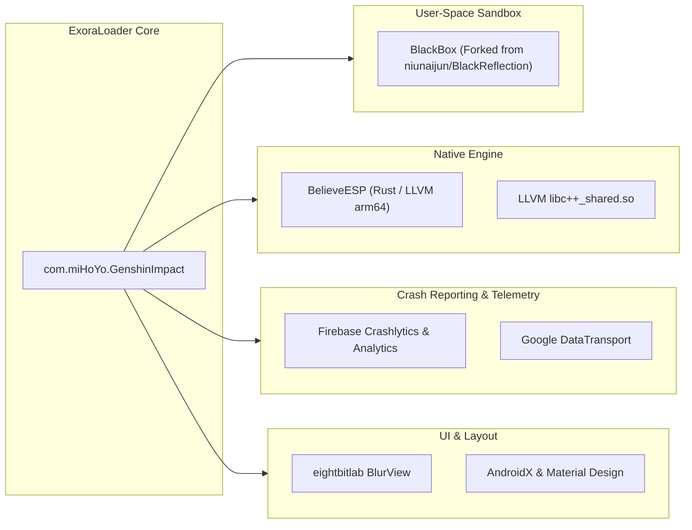

# Bundled Dependencies & Third-Party Library Analysis

## 1. Third-Party Frameworks Inventory

---

## 2. Component Dependency Table

| Library / SDK | Origin / Developer | Version / Artifact | Included Form | Purpose in ExoraLoader |
| :--- | :--- | :--- | :---: | :--- |
| **BlackBox** | niunaijun | v0.8.x+ (Custom fork) | DEX (`top.v.host`, `com.believeesp.*`) | Provides complete user-space Android virtualization, system service proxies, and VFS isolation. |
| **BelieveESP** | Proprietary | Custom build | ELF (`libBelieveEsp.so`) | Memory scanning, inline hooking of game modules (`libUE4.so`), and overlay rendering. |
| **Firebase Crashlytics**| Google LLC | ~18.6.x | DEX + 4 Native SOs | Captures unhandled Java exceptions and native POSIX crash signals from guest processes. |
| **Firebase Analytics** | Google LLC | ~21.5.x | DEX (`com.google.firebase.analytics`) | Telemetry dispatching and device engagement metrics. |
| **Google DataTransport**| Google LLC | ~3.1.x | DEX (`com.google.android.datatransport`) | Reliable background event queueing and transport scheduling. |
| **eightbitlab BlurView**| eightbitlab | ~1.6.x | DEX (`eightbitlab.blurview`) | Real-time Gaussian blur rendering for frosted glass UI panels. |
| **AndroidX DataStore** | Google Android | ~1.0.x | DEX + `libdatastore_shared_counter.so` | Key-value data persistence with process-safe atomic counters. |
| **AndroidX AppCompat** | Google Android | ~1.6.x | DEX (`androidx.appcompat`) | Backwards compatibility for Android OS components and themes. |
| **Google Material** | Google LLC | ~1.11.x | DEX (`com.google.android.material`) | Material Design text fields, elevated cards, and switches. |
| **LLVM libc++** | LLVM Project | NDK r25+ | ELF (`libcxx_shared.so`) | Standard C++ runtime supporting native libraries. Extracted to `codeCacheDir` by `BoxApplication`. |

---

## 3. Native Shared Libraries Analysis (`arm64-v8a`)

| Library Name | Architecture | Size | Exported Symbols of Interest |
| :--- | :---: | :---: | :--- |
| `libBelieveEsp.so` | AArch64 | 544,032 B | `JNI_OnLoad`, `Java_com_miHoYo_GenshinImpact_utils_ContainerLinkHandler_*`, Rust panic handlers. |
| `libcxx_shared.so` | AArch64 | 3,436,792 B | Standard C++ ABI symbols (`_Znwm`, `_ZdlPv`, `std::string`, `std::vector`). |
| `libcrashlytics.so` | AArch64 | 232,152 B | Crashlytics native unwinder initialization routines. |
| `libcrashlytics-common.so`| AArch64 | 864,800 B | Core native crash capture routines, signal stack frames parser. |
| `libcrashlytics-handler.so`| AArch64 | 222,248 B | POSIX signal installer (`sigaction` hooks for `SIGSEGV`, `SIGBUS`, `SIGABRT`). |
| `libcrashlytics-trampoline.so`| AArch64 | 4,928 B | Low-level assembly trampoline for signal re-dispatch. |
| `libdatastore_shared_counter.so`| AArch64 | 7,112 B | Atomic counter increments for AndroidX DataStore file locks. |

