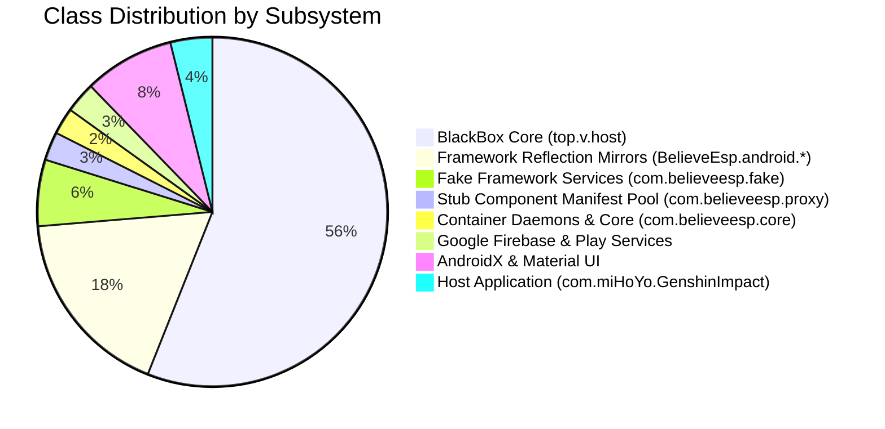

# Package Structure & Hierarchy Analysis

## 1. Class Distribution Overview

The Dalvik bytecode contained in `raw_dex/classes.dex` was decompiled into **6,228 Smali classes** and **5,344 Java source files**. The classes are structured into distinct functional modules:



---

## 2. Top-Level Package Breakdown

| Package Namespace | Class Count | Role & Implementation Details |
| :--- | :---: | :--- |
| `top.v.host.*` | 3,489 | **BlackBox Virtualization Core & Cryptography.** Implements system service interceptors, Binder proxies, reflection helpers, and the encrypted string table (`top.v.host.nc1.l` / `ox1.t`). |
| `BelieveEsp.android.*` | 1,100 | **BlackReflection Framework Mirrors.** Pre-compiled reflection mirrors for Android OS classes across API 24–36 (`android.app`, `android.content`, `android.os`, `android.location`, `android.view`, `android.net`, `android.media`, `android.telephony`). |
| `com.believeesp.fake.*` | 383 | **Fake Service Providers.** High-level mocks replacing Android OS system services when queried by the virtualized game (`FakePackageManager`, `FakeActivityManager`, `FakeAppOpsManager`, `FakeWifiManager`). |
| `com.believeesp.proxy.*` | 164 | **Stub Component Pool.** Pre-allocated components declared in `AndroidManifest.xml` (`ProxyActivity$P0..P24`, `ProxyService$P0..P24`, `ProxyJobService$P0..P24`, `ProxyContentProvider$P0..P24`, `TransparentProxyActivity$P0..P24`). |
| `com.believeesp.core.*` | 153 | **Container Infrastructure.** `SystemCallProvider`, `DaemonService`, process lifecycle controllers, and JNI bridge to `libBelieveEsp.so`. |
| `com.miHoYo.GenshinImpact.*` | ~60 | **Host Application Logic.** `BoxApplication` (sandbox bootstrapper), `LogAct` (gateway/auth), `MAct` (UI dashboard), `ContainerLinkHandler` (JNI interface), `DiagnosticsReceiver` (IPC server), and `FieldDiagnostics`. |
| `com.google.firebase.*` | ~120 | **Crash Telemetry & Analytics.** Firebase Crashlytics native crash dispatcher and analytics backend. |
| `androidx.*` | ~520 | **UI & Data Persistence.** Android Jetpack AppCompat, DataStore, Fragment, and Material Design widgets. |
| `eightbitlab.blurview.*` | ~15 | **Graphics & Effects.** Hardware-accelerated Gaussian frosted glass rendering for `MAct`. |

---

## 3. Detailed Component Map of `com.miHoYo.GenshinImpact`

The application logic resides in the root package:

```
com/miHoYo/GenshinImpact/
├── BoxApplication.java             # Custom Application subclass; initializes container
├── LogAct.java                     # Main Launcher Activity; VPN & license gate
├── MAct.java                       # Main Dashboard Activity; OBB copier & container launcher
│
├── utils/
│   ├── ContainerLinkHandler.java   # JNI bridge to libBelieveEsp.so
│   ├── DiagnosticsReceiver.java    # Local abstract Unix domain socket server
│   ├── FieldDiagnostics.java      # Firebase Crashlytics custom telemetry adapter
│   ├── SdkActivation.java          # Remote license verification client
│   └── BelieveBackgroundView.java  # Custom animated canvas UI view
```

