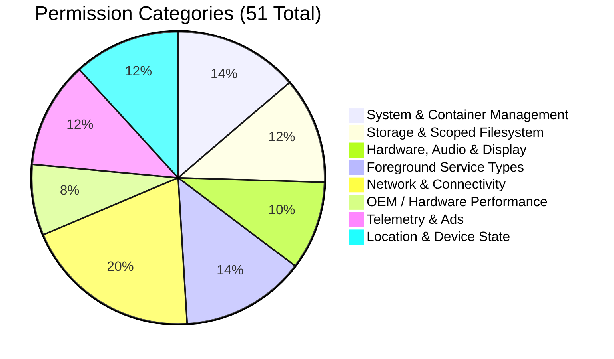

# Android Permissions Analysis

## 1. Permissions Audit Overview

ExoraLoader requests **51 distinct Android permissions** in `AndroidManifest.xml`. Because the application acts as a host virtualization container for complex 3D gaming titles, it declares an extensive permission set so that any permission requested by the guest application (e.g. voice chat, storage, network, camera) is already granted to the host process by the Android OS.

---

## 2. Categorized Permissions Inventory

### 2.1. System & Container Execution Privileges

| Permission Name | Protection Level | Purpose & Architectural Usage |
| :--- | :---: | :--- |
| `android.permission.MANAGE_EXTERNAL_STORAGE` | Signature / Special | Bypasses Android 11+ Scoped Storage restrictions, allowing the loader to read and mirror game expansion archives (`/Android/obb/`). |
| `android.permission.SYSTEM_ALERT_WINDOW` | Signature / Special | Required to render floating canvas overlays (ESP visual modifications) directly over the guest game window. |
| `android.permission.QUERY_ALL_PACKAGES` | Normal / Special | Allows the loader to detect installed PUBG/BGMI variants on the device without filtering restrictions. |
| `android.permission.REQUEST_INSTALL_PACKAGES`| Normal / Special | Enables installing split APK packages or plugins into the virtual container environment. |
| `android.permission.REQUEST_DELETE_PACKAGES` | Normal | Allows managing virtual sandbox package uninstalls. |
| `android.permission.REORDER_TASKS` | Normal | Allows bringing the guest game task to the foreground during state transitions. |
| `android.permission.REQUEST_IGNORE_BATTERY_OPTIMIZATIONS`| Normal | Requests exemption from OS battery saver killing the background container daemons. |

---

### 2.2. Filesystem & Media Access

| Permission Name | Protection Level | Purpose & Architectural Usage |
| :--- | :---: | :--- |
| `android.permission.READ_EXTERNAL_STORAGE` | Dangerous | Legacy storage access for reading game data files on Android 7.0–10. |
| `android.permission.WRITE_EXTERNAL_STORAGE` | Dangerous | Legacy storage access for writing game data and logs. |
| `android.permission.READ_MEDIA_IMAGES` | Dangerous | Android 13+ granular media permission pass-through for guest games. |
| `android.permission.READ_MEDIA_VIDEO` | Dangerous | Android 13+ video permission pass-through. |
| `android.permission.READ_MEDIA_AUDIO` | Dangerous | Android 13+ audio permission pass-through. |

---

### 2.3. Audio, Camera & Display Performance

| Permission Name | Protection Level | Purpose & Architectural Usage |
| :--- | :---: | :--- |
| `android.permission.RECORD_AUDIO` | Dangerous | Microphonic pass-through for in-game squad voice communication. |
| `android.permission.MODIFY_AUDIO_SETTINGS` | Normal | Allows tuning audio routing for voice chat overlays. |
| `android.permission.CAMERA` | Dangerous | Camera pass-through for games supporting AR or QR-code scanning. |
| `android.permission.MODIFY_REFRESH_RATE` | Normal | Allows the game to request high refresh rates (90Hz, 120Hz). |
| `android.permission.VIBRATE` | Normal | Haptic feedback pass-through for game hit markers. |

---

### 2.4. Foreground Service Subtypes (Android 14+ Compliance)

To prevent foreground services from being blocked on Android 14+ (API 34), the manifest declares multiple specialized foreground service types:
- `android.permission.FOREGROUND_SERVICE`
- `android.permission.FOREGROUND_SERVICE_SPECIAL_USE`
- `android.permission.FOREGROUND_SERVICE_CONNECTED_DEVICE`
- `android.permission.FOREGROUND_SERVICE_PHONE_CALL`
- `android.permission.FOREGROUND_SERVICE_MICROPHONE`
- `android.permission.FOREGROUND_SERVICE_DATA_SYNC`
- `android.permission.FOREGROUND_SERVICE_CAMERA`

---

### 2.5. OEM-Specific Performance & Gaming Extensions

The application declares vendor-specific permissions allowing it to communicate with underlying Qualcomm Snapdragon, MediaTek, and Oppo gaming optimization daemons:

| Permission Name | Vendor / Platform | Function |
| :--- | :---: | :--- |
| `com.qualcomm.qti.permission.USE_GAME_PERFORMANCE_SERVICE` | Qualcomm | Enables requesting Snapdragon CPU/GPU clock boost during gameplay. |
| `com.qti.permission.USE_GAME_PERFORMANCE_SERVICE` | Qualcomm | Alternate Snapdragon performance service binding. |
| `com.mediatek.permission.CTA_ENABLE_WIFI` | MediaTek | MediaTek low-latency Wi-Fi game mode privilege. |
| `com.oppo.permission.SAFE_MANAGER` | Oppo / Realme / OnePlus | Bypasses ColorOS background process killing. |

