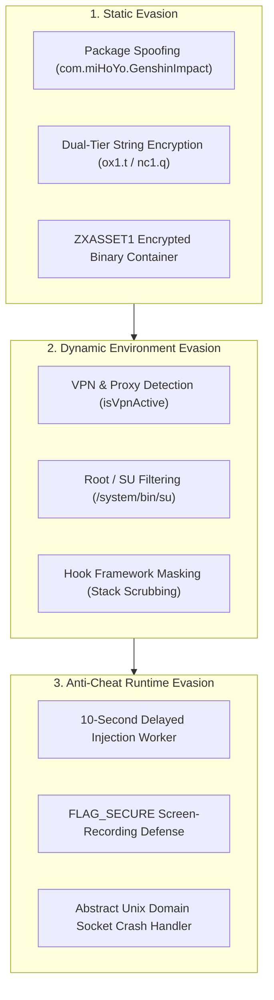

# Security, Anti-Analysis & Evasion Analysis

## 1. Security & Anti-Analysis Architecture

ExoraLoader implements a multi-layered defensive strategy combining static obfuscation, dynamic runtime cloaking, network inspection resistance, and anti-cheat evasion techniques.



---

## 2. In-Depth Mechanism Analysis

### 2.1. Package Spoofing & Identity Masquerading
- **Mechanism:** The application registers under the application ID `com.miHoYo.GenshinImpact`.
- **Evasion Impact:** Anti-cheat software routinely queries `PackageManager.getInstalledPackages()` looking for known cheating tools, dual-app clones, or hooking frameworks. By borrowing the identity of a globally recognized game title, the loader evades standard string-based package blacklist filters.
- **Detection Vector:** If the genuine *Genshin Impact* application is installed on the device, the Android OS package manager rejects installation with `INSTALL_FAILED_ALREADY_EXISTS`.

---

### 2.2. String Obfuscation & Dalvik Sign-Extension Trap
- **Mechanism:** All critical URLs, target package names (`com.pubg.imobile`), filesystem paths, and class names are encrypted in `top.v.host.nc1.l` (132 Unicode constants) and decrypted on demand via `top.v.host.nc1.q(long, String[])`.
- **Key Mixing:** `top.v.host.ox1.t(long)` applies a 64-bit non-linear permutation round:
  $$v_1 = x \oplus (x \gg 33), \quad v_2 = (v_1 \times \mathtt{0xFF51AFD7ED558CCD}_{16}) \pmod{2^{64}}, \quad \dots$$
- **Analysis Trap:** In Dalvik bytecode, register values are 32-bit sign-extended before 64-bit bitwise shifts (`int-to-long`). Decompilers or emulators assuming standard unsigned 32-bit packing produce invalid chunk indices and crash with array boundary exceptions.

---

### 2.3. Active VPN & Proxy Inspection (`LogAct.isVpnActive()`)
- **Mechanism:** Before performing authentication or fetching remote configuration, `LogAct` queries the active network via `ConnectivityManager.getNetworkCapabilities()`.
- **Check:** Asserts that `NetworkCapabilities.TRANSPORT_VPN` is NOT set.
- **Evasion Impact:** Prevents security researchers from inspecting network traffic using proxy tools (Charles, Fiddler, Burp Suite, mitmproxy). If active, the app halts execution and prompts the user to disconnect.

---

### 2.4. Root & Xposed Cloaking
Inside `BoxApplication.attachBaseContext`, BlackBox initializes with cloaking flags:
```java
top.v.host.s8.g(this, context); // Enforces hideRoot=true and hideXposed=true
```
- **Root Cloaking:** libc calls (`open`, `stat`, `access`) referencing `/system/bin/su`, `/system/xbin/su`, or `/sbin/su` are intercepted and return `ENOENT` (File not found).
- **Xposed Cloaking:** Calls to `Throwable.getStackTrace()` are filtered to strip stack frames belonging to `de.robv.android.xposed` or `com.elderdrivers.riru`.

---

### 2.5. 10-Second Delayed Injection Gate
- **Mechanism:** In `ContainerLinkHandler.prepareProtectedLaunch()`, the native engine is primed, but active memory patches and entity hooks in `libUE4.so` are deferred:
  ```java
  ContainerLinkHandler.scheduleDelayedInjection(10000); // 10,000 ms sleep
  ```
- **Evasion Impact:** Anti-cheat modules (`libanogs.so`, `libTssSec.so`) execute comprehensive memory checksum scans and page protection verifications during splash screen loading. By remaining dormant for 10 seconds, the cheat engine allows the game to complete its integrity audit before hooking game memory.

---

### 2.6. Screen Recording Camouflage (`FLAG_SECURE`)
- **Mechanism:** When the user enables the **Hide ESP** toggle (`switchHideEsp`), the overlay window sets `WindowManager.LayoutParams.FLAG_SECURE`.
- **Evasion Impact:** The Android WindowManager renders a black canvas over the overlay coordinates during screen recording or screenshot captures, preventing automated gameplay capture detectors from flagging visual wallhacks.

---

### 2.7. Encrypted Asset Payload (`ZXASSET1`)
- **Mechanism:** The secondary native payload `assets/data_pack.bin` is stored as a 4.24 MB encrypted container with a magic header `ZXASSET1`.
- **Integrity Validation:** Validated against `assets/data_pack.json` SHA-256 (`bff6ef325c039fc762542dc097b2994069c9ba6cbc455ac5097e0e23b1420940`).
- **Decryption:** Handled dynamically in memory by `libBelieveEsp.so`, preventing static inspection of supplementary modules without native debugging.

